# Dendron

Dendron is a writing app for Mac and iPhone that opens and saves Scrivener projects.

## Mac

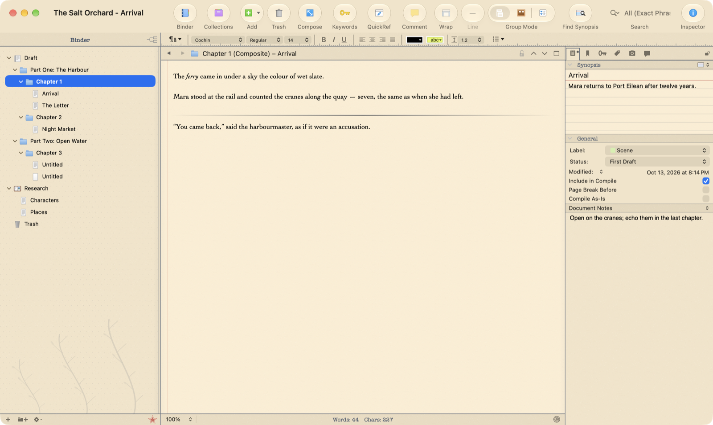

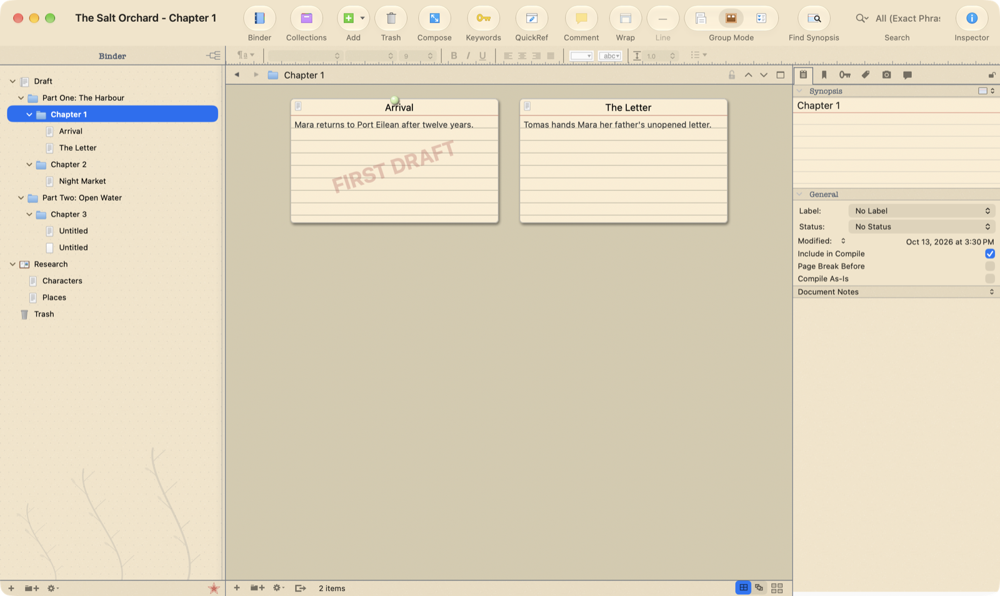

## iPhone

| Library | Binder | Editor | Reading |
|:---:|:---:|:---:|:---:|
| 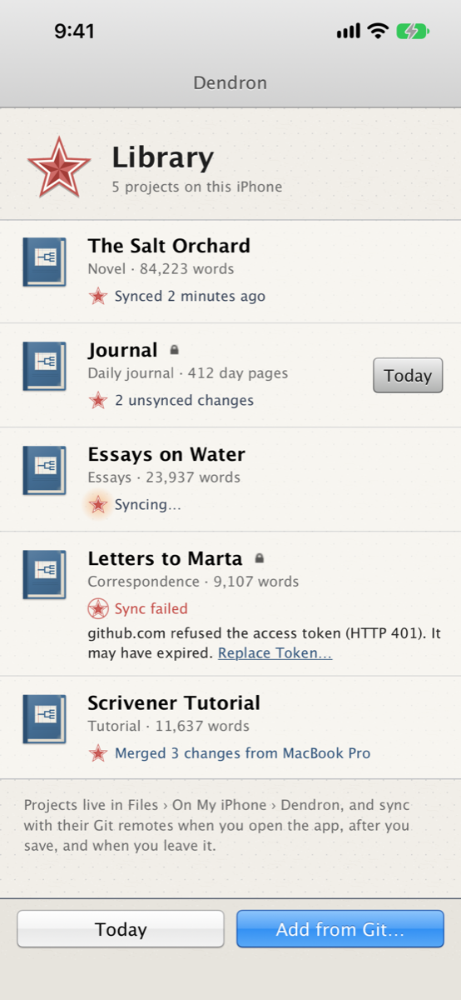 | 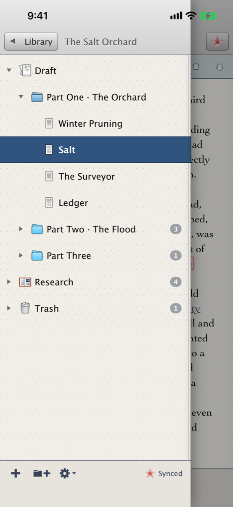 | 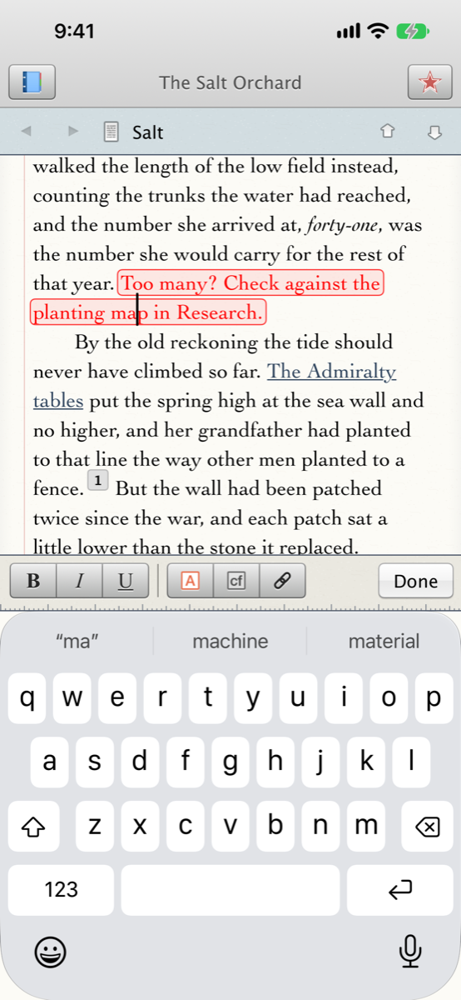 | 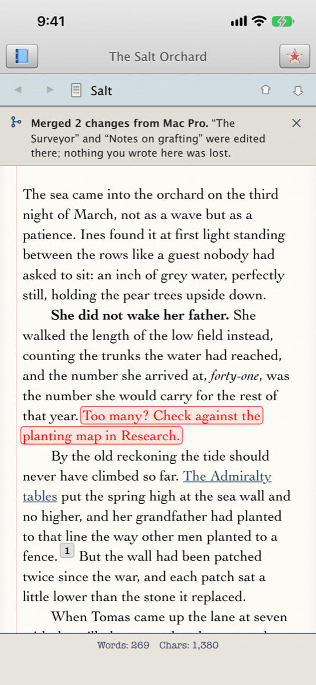 |

| Footnotes | Today page | Dictation: speaking | Dictation: typed |
|:---:|:---:|:---:|:---:|
| 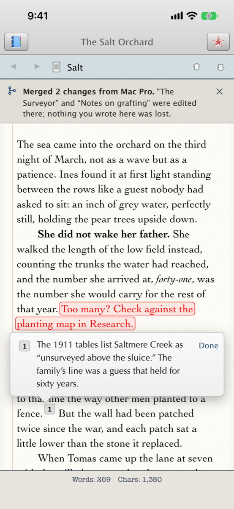 | 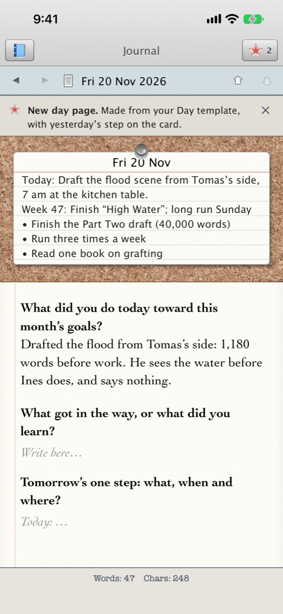 | 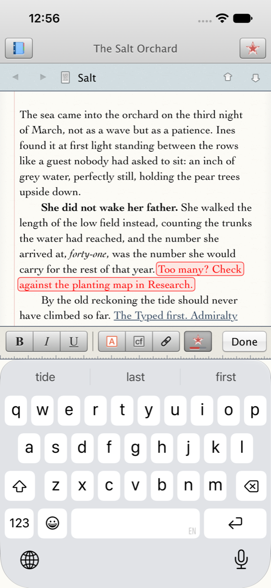 | 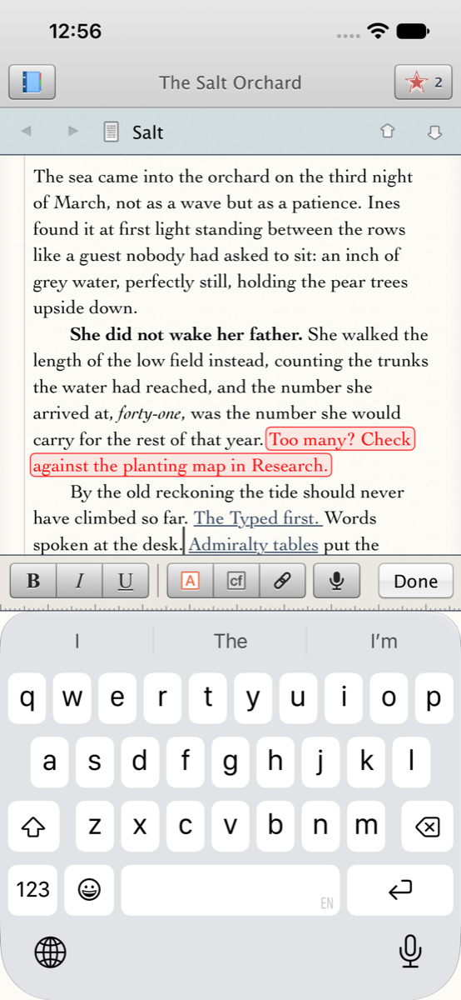 |

| Dictation settings | Synced | Merged | Merge report |
|:---:|:---:|:---:|:---:|
| 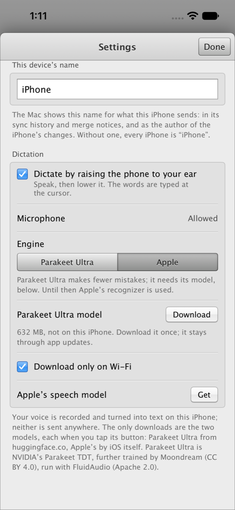 | 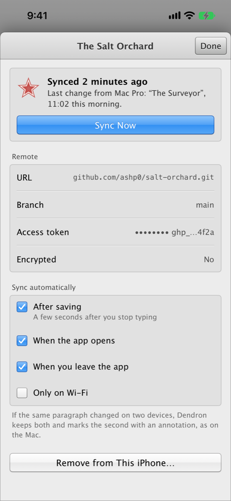 | 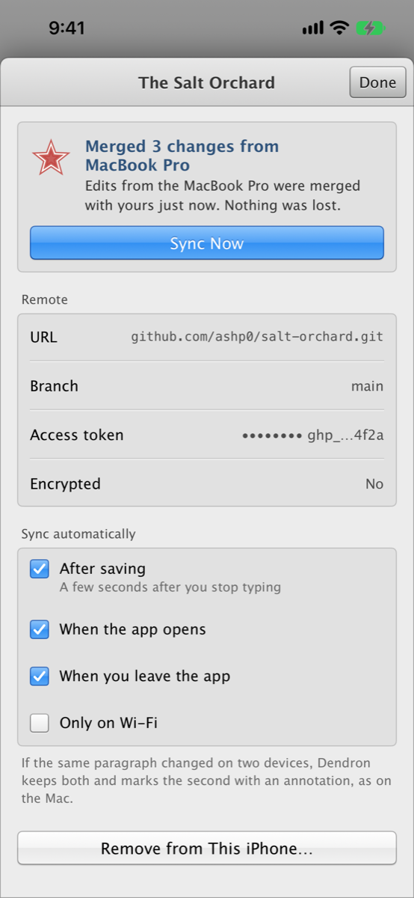 | 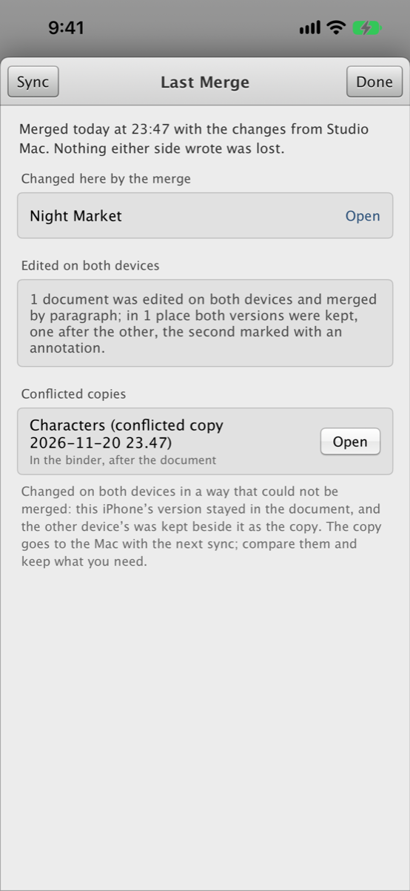 |

## What's inside

- A Mac app in AppKit and an iPhone app in SwiftUI (Swift 6), on one shared Objective-C core.
- Fast on old hardware: on a 2013 Mac running OS X 10.9 it opens a million-word project in 0.6 seconds, and each keystroke lands in about 2 milliseconds. Project search and the outliner were profiled and made about three times faster.
- Mac and iPhone sync through Git. More than 3,400 automated checks cover sync, including tests that break a sync halfway. The iPhone app has 156 unit and UI tests.
- On-device dictation on iPhone (added November 2026): raise the phone to your ear, speak, lower it, and the words are typed at the cursor, transcribed on the phone by a Parakeet model. No button, no mode.
- Designed and built alone by [Ashwin Paudel](https://github.com/ashp0).

## Source and demo

The source code is private. A live demo is available on request: reach me through [github.com/ashp0](https://github.com/ashp0) or [linkedin.com/in/ashpaudel](https://www.linkedin.com/in/ashpaudel).

© 2026 Ashwin Paudel. All rights reserved.
